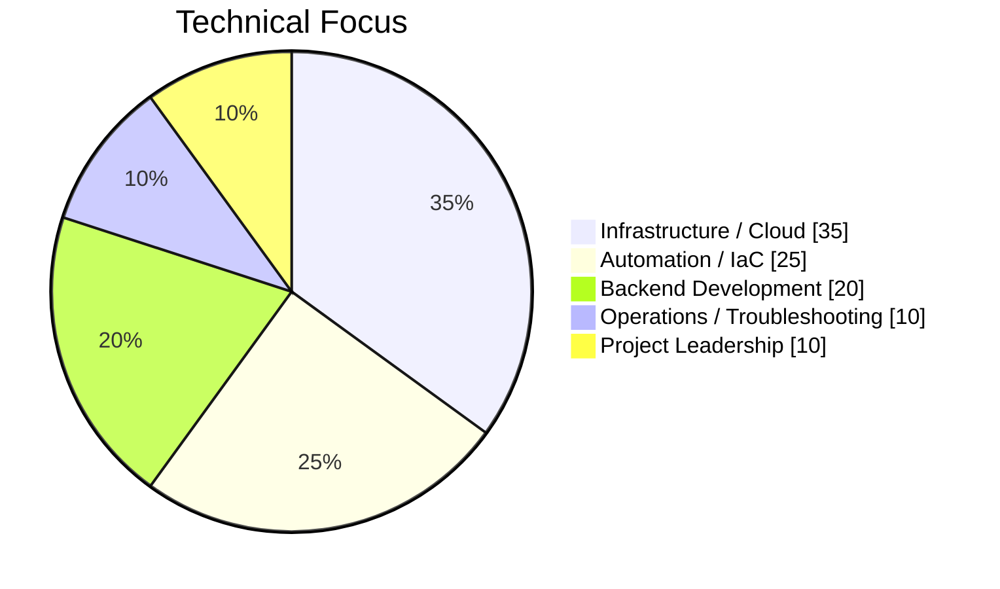
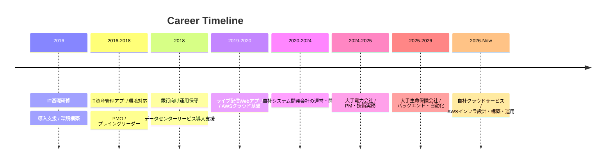

# Engineering Portfolio
### Infrastructure / Backend / Automation

エンジニアとして**約10年**、インフラ領域で**約5年**の実務経験。  
要件定義から設計・構築、開発、テスト、運用保守まで一貫して対応してきました。

  
  
  
  

> [!IMPORTANT]
> **業務上のソースコードや成果物は守秘義務のため公開していません。**  
> このポートフォリオでは、公開可能な範囲で**実務経験・強み・実績の要点**を可視化しています。  
> **具体的なプロジェクト詳細、担当工程、利用技術、成果については、応募時に提出している職務経歴書をご参照ください。**

---

## Snapshot

<table>
<tr>
<td align="center" width="25%">
  <h3>10+</h3>
  Engineer Career 
  エンジニア経験年数
</td>
<td align="center" width="25%">
  <h3>5+</h3>
  Infrastructure Years 
  インフラ実務経験
</td>
<td align="center" width="25%">
  <h3>50</h3>
  Max Team Size 
  最大プロジェクト規模
</td>
<td align="center" width="25%">
  <h3>52</h3>
  AWS Accounts 
  運用対象アカウント数
</td>
</tr>
</table>

---

## Strengths at a Glance

<table>
<tr>
<td width="50%" valign="top">

### Core Domains
- Linux / Cloud Infrastructure
- IaC / Automation
- Backend Development
- Operations / Troubleshooting
- Project Leadership

</td>
<td width="50%" valign="top">

### Typical Responsibilities
- 要件定義 / 設計 / 構築
- 開発 / テスト / 運用保守
- 障害調査 / 復旧 / 改善
- 自動化 / 標準化 / ドキュメント整備
- 顧客調整 / 進捗・課題・コスト管理

</td>
</tr>
</table>

---

## Focus Areas

---

## Key Achievements

<table>
<tr>
<td width="50%" valign="top">

### Linux / Infrastructure Automation
- **Ansible**を用いたLinux運用自動化基盤の設計・構築
- 初期構築、OS設定、複数サーバ一括設定変更を自動化
- ソフトウェア導入、サービス起動停止、パッチ適用、定期運用に対応
- AWSからIBM Cloudへの要件変更案件で、Linux構築部分をIaC化し、**通常予定より約1か月早く納品**

</td>
<td width="50%" valign="top">

### Cloud Infrastructure / Operations
- **CloudFormation**でVPC / Subnet / Route Table / SG / IAM / ALB / EC2 / RDS等をコード化
- 複数AWS環境の設定変更、監視、ログ確認、障害切り分けを担当
- **約52個のAWSアカウント**を扱う運用環境で、手順整備・誤操作防止・コスト確認などの改善を推進

</td>
</tr>
<tr>
<td width="50%" valign="top">

### Backend Development
- Python / PHP / JavaScript / Java / C# / C の実務経験
- PostgreSQL / MySQL / Oracle / SQL Server を利用
- インフラとアプリケーションの両面から障害の切り分け・改修に対応

</td>
<td width="50%" valign="top">

### Project Leadership
- **PL / PM / PMO**としてプロジェクト推進
- **最大約50名規模**のプロジェクト管理経験
- **最大3案件を並行**して推進
- 顧客・開発チーム・オフショアメンバーとの調整を実施

</td>
</tr>
</table>

---

## Technical Stack

### Infrastructure / Cloud

  
  
  
  
  
  

### Automation / DevOps

  
  
  
  
  
  

### Backend / Database

  
  
  
  
  
  
  
  

### Tools / Operations

  
  
  
  
  
  
  

---

## Experience Timeline

---

## Skill View

| Area | Level / Experience | Notes |
|---|---|---|
| Linux / Infra | ★★★★★ | 設計・構築・運用・障害調査 |
| AWS / Cloud | ★★★★☆ | CloudFormation / 複数アカウント運用 |
| Ansible / Automation | ★★★★★ | 自動化基盤設計・構築 |
| Backend | ★★★☆☆ | 設計・開発・改修 |
| Project Leadership | ★★★★☆ | PL / PM / PMO |

> ※ 詳細な技術レベル分類・スキルマトリクスは職務経歴書に記載しています。

---

## Engineering Approach

私は、与えられた作業をこなすだけでなく、常に**「より良い方法はないか」**を考え、調査し、試し、必要であれば周囲を巻き込みながら改善することを大切にしています。

特に以下の視点を重視しています。

- 手作業を自動化・標準化できないか
- 障害を復旧するだけでなく、再発防止につなげられないか
- 複数環境をより安全に運用できないか
- インフラだけでなくサービス全体として改善できないか

---

## Career Details

このページは、実務経験の概要を**短時間で確認いただくためのポートフォリオ**です。  
**より詳細な内容については、応募時に提出している「職務経歴書」をご参照ください。**

職務経歴書には以下を記載しています。

- 各プロジェクトの詳細
- 担当した役割・工程
- チーム規模
- 技術スタック
- 自動化・運用改善の具体例
- プロジェクトマネジメント経験
- 技術スキルと対応レベル
- 今後取り組みたい技術領域

---

**Thank you for visiting this portfolio.**  
詳細確認の際は、ぜひ**職務経歴書**もあわせてご覧ください。

_Last updated: 2026-10-26_
